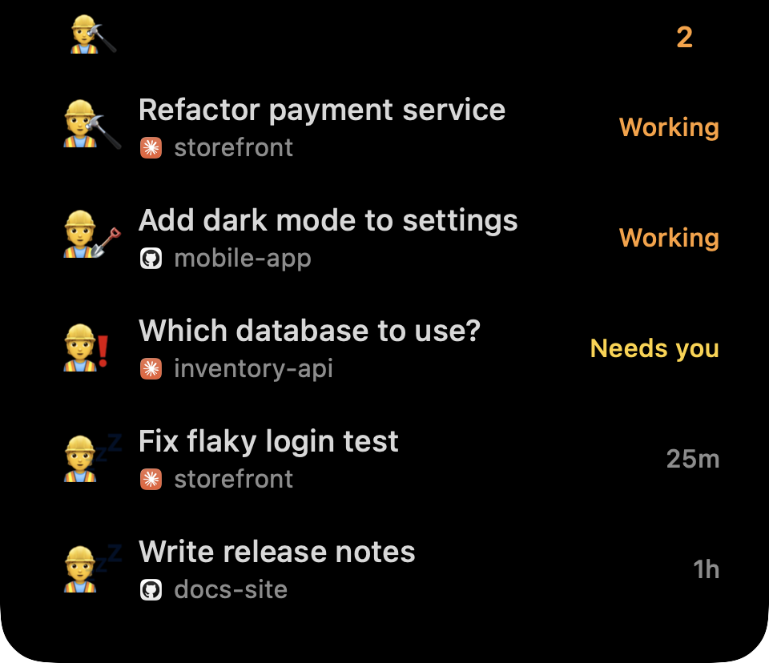

# Session Notch

A tiny macOS widget that sits at the top of your screen, around the camera notch, and shows what your AI coding agents are doing. It tracks **Claude Desktop** and the **GitHub Copilot** app.

Each session is a little construction worker:

| Worker | Meaning |
| --- | --- |
| 🔨 / 🪏 hammering or shovelling | the session is **working** |
| ❗ waving | the session **needs you** (a question or plan is waiting for an answer) |
| 💤 sleeping | the session is **idle** |

**Collapsed**: the most urgent state on the left, how many sessions are in it on the right.


**Hover** to expand the list. Click a session to open it in its app.



It shows up on every screen, on the notch where there is one and as a slim pill where there isn't.

## Build and run

You need macOS 14 or later and a Swift toolchain (Xcode or the Command Line Tools).

```bash
./build.sh
open "Notch Agents.app"
```

`build.sh` runs a release build and assembles `Notch Agents.app` with an ad-hoc code signature. The app has no Dock icon; right-click the widget and choose Quit to close it.

Useful flags, run the binary inside the app bundle:

```bash
"Notch Agents.app/Contents/MacOS/NotchAgents" --demo      # sample sessions, no desktop app needed
"Notch Agents.app/Contents/MacOS/NotchAgents" --expanded  # start expanded
"Notch Agents.app/Contents/MacOS/NotchAgents" --dump      # print the current sessions and exit
```

Set `NOTCH_IDLE_HOURS` to change how long an idle session stays listed (default 12).

## How it works

The widget polls every 2 seconds and only reads local files. Nothing leaves your machine.

- **Claude Desktop**: session files under `~/Library/Application Support/Claude/claude-code-sessions`. A session is *working* while its transcript in `~/.claude/projects` is being written, and *needs you* when the last turn is blocked or the transcript ends with an unanswered `AskUserQuestion` or `ExitPlanMode`.
- **GitHub Copilot app**: its local database at `~/.copilot/data.db`, opened read-only.

These are internal, undocumented formats, so an app update can break them.

Clicking a Claude session uses the `claude://` link. The Copilot link (`ghapp://sessions/<id>`) is a best guess and untested.

## Adding another app

Implement `AgentProvider` (see `Sources/NotchAgents/Model.swift`), return normalized `Agent` values, and add it to the list in `AgentStore`.
